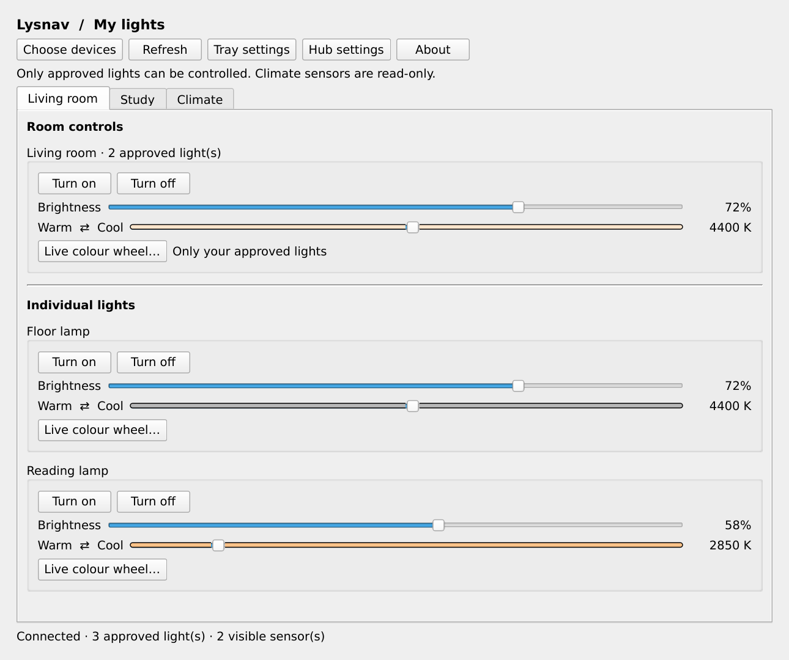
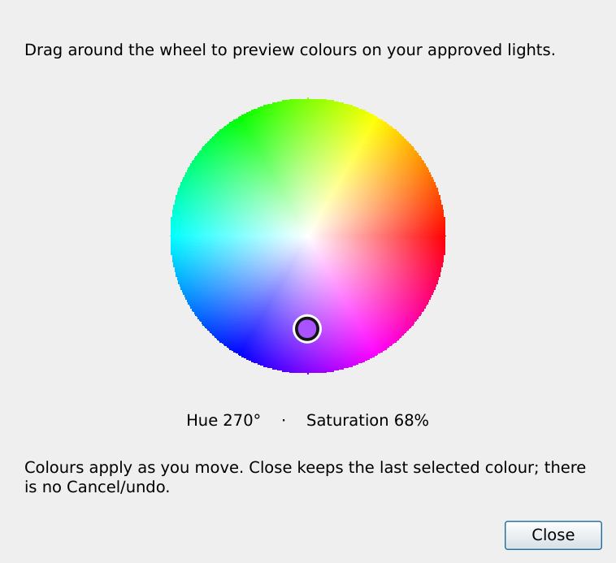
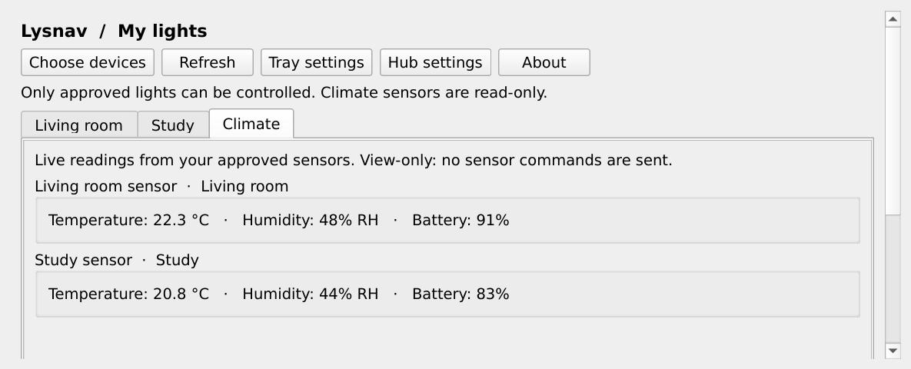
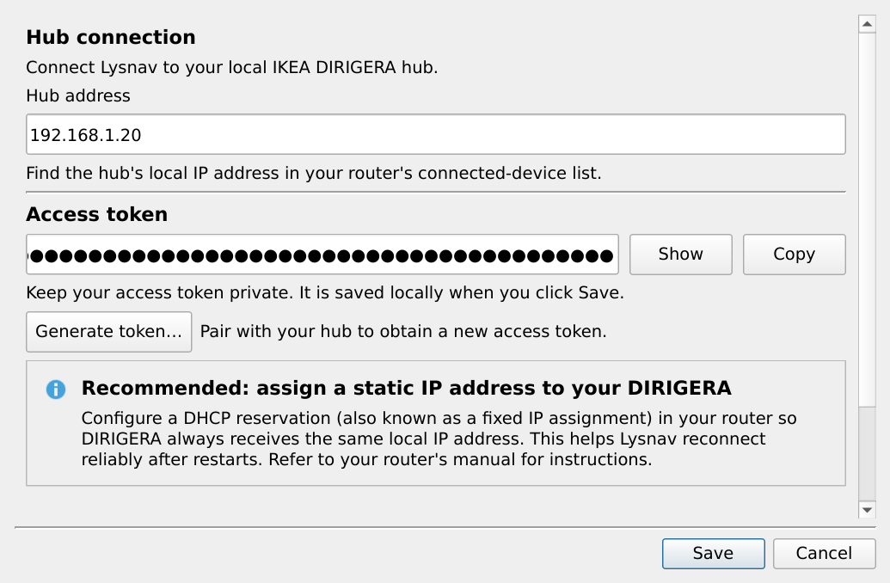
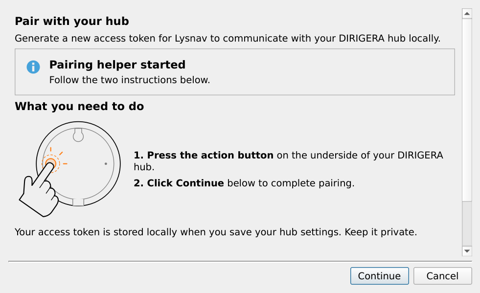
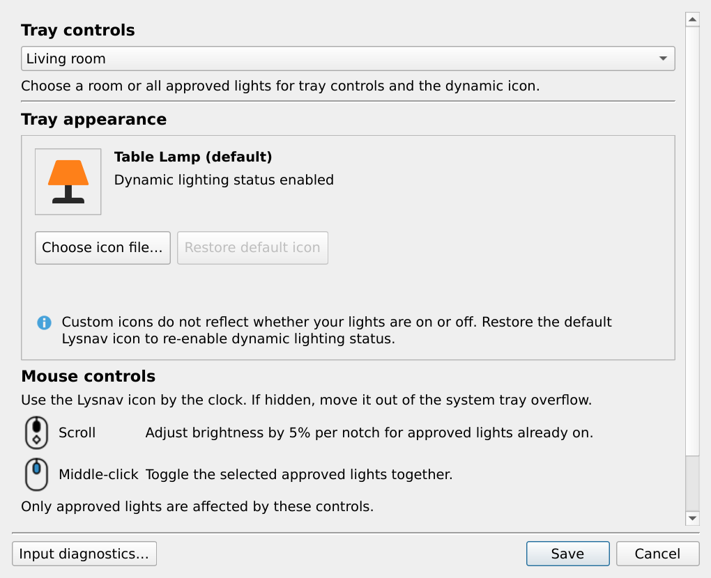
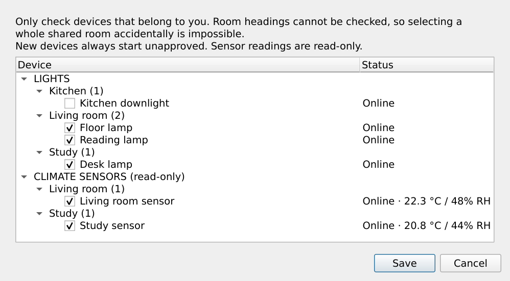

# Lysnav for Windows


The name **Lysnav** is a Scandinavian-inspired combination of *lys* (light) and *nav* (hub).

Lysnav is an independent third-party application and is not affiliated with, endorsed by, or sponsored by IKEA.

**Control your IKEA DIRIGERA smart home hub from the Windows system tray.**

Dim lights without opening a window, control individual bulbs or whole rooms,
and see temperature and humidity at a glance. The app talks directly to your
hub over your local network.

[](LICENSE)
[](#requirements)

This is the Qt-based Windows port of [Lysnav for KDE Plasma](https://github.com/alsiniz/lysnav-plasma),
based on upstream commit [`a334176`](https://github.com/alsiniz/lysnav-plasma/commit/a334176309953518c76e9b2339e4c152c99556ae).

App screenshots use sample rooms and devices.

<p align="center">
  
</p>

## Why Lysnav for Windows?

- **Local control.** Use your existing hub over the LAN without a cloud login
  or a separate automation server.
- **Quick tray controls.** Scroll over the lamp icon to dim or brighten.
  Middle-click to toggle your selected approved lights.
- **In-app pairing.** Generate the hub access token from **Hub settings**.
- **Shared households.** Choose exactly which lights the app can control and
  which climate sensors it can read.
- **Live colour control.** Adjust power, brightness, and colour temperature
  for rooms or individual bulbs. Preview changes with the live colour wheel
  on bulbs that support RGB.

## See it in action

### Live colour control

<p align="center">
  
</p>

### Climate readings

<p align="center">
  
</p>

## Requirements

- **Windows 11 x64.**
- An **IKEA DIRIGERA hub** with lights or climate sensors set up in IKEA Home Smart.
- Your PC and hub must be able to reach each other on the local network.

The installer and portable executable include Python and Qt. Your existing
hub continues to manage its devices.

## Install

Download the **v1.0.0** from [GitHub Releases](https://github.com/alsiniz/lysnav-windows/releases/tag/v1.0.0).

| Download | How to use it |
| --- | --- |
| **Installer** · `Lysnav-Windows-1.0.0-x64-Setup.exe` | Installs for your Windows account, adds a **Lysnav for Windows** Start menu shortcut, and can be removed from **Settings → Apps**. Select **Start Lysnav when I sign in** during setup to enable startup. |
| **Portable** · `Lysnav-Windows-1.0.0-x64-Portable.exe` | Run the executable directly. It extracts its bundled libraries to a temporary folder at launch. |

> **Windows publisher verification.** This release is unsigned.
> Microsoft SmartScreen can show an unverified-publisher warning, and Smart App
> Control can block execution. A publicly trusted signature is the supported
> route for distributing the app to machines with Smart App Control enabled.
> [Microsoft Smart App Control FAQ](https://support.microsoft.com/en-us/windows/security/threat-malware-protection/smart-app-control-frequently-asked-questions)

### Connect your hub through the app

1. Open **Hub settings** and enter the hub's local IP address or hostname.
   Look in your router's connected-device list if you need the address.
2. Select **Generate token**. Press the physical action button underneath the
   hub when prompted, then select **Continue**.
3. Select **Save** to keep the new token. The app fills in the masked token field.
4. Open **Choose devices** and approve the bulbs and sensors you want to use.

A DHCP reservation in your router helps the hub keep the same IP address.

<p align="center">
  
</p>

<p align="center">
  
</p>

## Control from the Windows tray

Look for the **lamp icon** by the clock. If Windows puts it behind the
tray chevron, drag it out to the area by the clock. Choose a room or **All approved lights**
in **Tray settings**. The **Tray appearance** section previews the selected icon.
Choose **Choose icon file…** to open the native Windows file picker and select
a valid `.ico` file. Custom icons stay static instead of reflecting lighting
power; **Restore default icon** restores the live lamp. Save applies
the selection; Cancel leaves it unchanged. Lysnav remembers the selected file
path between launches, so keep the file in a permanent location. If it is
unavailable when Lysnav starts or the settings are saved, the default lamp is
used. The full-colour application and taskbar button icons are unaffected.

<p align="center">
  
</p>

| Interaction | What happens |
| --- | --- |
| **Hover** | See temperature and humidity from approved climate sensors. |
| **Scroll up or down** | Change brightness in 5% steps for selected approved lights that are already on. |
| **Middle-click** | Toggle the selected approved lights together. |
| **Left-click** | Open the full controls window. |
| **Right-click** | Open the tray menu for quick actions, settings, and Quit. |

Existing room choices are kept on upgrade. If you previously used Automatic with approvals in more than one room, choose a tray selection.

A brief overlay shows the target brightness as you scroll. Closing the window
keeps the app in the tray. Select **Quit** from the tray menu or press **Ctrl+Q**
in the main window to exit.

## Shared households and privacy

- **Only approved bulbs receive commands.** Approvals are tied to device IDs
  and their rooms. Review a bulb again if it moves to a different room.
- **Climate sensors are read-only.** The Climate tab can combine temperature
  and humidity from supported split-endpoint devices such as IKEA TIMMERFLOTTE.
- **Keep your access token private.** The hub token can control the whole hub.
  The installer and portable executable both use
  `%LOCALAPPDATA%\Lysnav\config.json` for settings, including the token.
- **The app uses the unofficial local DIRIGERA API.** IKEA firmware changes
  may affect compatibility.

<p align="center">
  
</p>

## Troubleshooting

| Symptom | What to check |
| --- | --- |
| Pairing cannot start | Enter the hub address by itself, without a URL or port. Check reachability on the local network. |
| Pairing fails after you click Continue | Start a new pairing request and press the physical action button when prompted. |
| A bulb or sensor is missing | Open **Choose devices** and review newly added or moved devices. |
| Colour options are unavailable | Check whether the bulbs support RGB or colour temperature. |
| Tray scrolling or middle-click does nothing | Move the lamp icon out of tray overflow. Open **Tray settings → Input diagnostics** to see whether input reached the app. |

When reporting a problem, include the app version, Windows version, and
the steps to reproduce it. Keep your token and configuration file private.

## Run from source

Quit any running pre-rebrand version first. Lysnav reads its saved pairing, device approvals, and preferences from the previous Windows configuration. Subsequent changes are saved to `%LOCALAPPDATA%\Lysnav\config.json`.

In PowerShell on Windows with Python 3.12 x64:

```powershell
py -3.12 -m venv .venv
.\.venv\Scripts\python.exe -m pip install -r requirements.txt
.\.venv\Scripts\python.exe app.py
```

## Build and test

Install Inno Setup 6, then run:

```powershell
.\.venv\Scripts\python.exe -m pip install -r requirements-build.txt
.\.venv\Scripts\python.exe -m unittest discover -v
.\.venv\Scripts\python.exe packaging/build_windows.py --portable-exe
```

The installer installs `Lysnav.exe`. New download names follow `Lysnav-Windows-<version>-x64-Setup.exe` and `Lysnav-Windows-<version>-x64-Portable.exe`. The packages are written to `release\`. Pass `--iscc` if the compiler is
in a custom location. The **Windows builds** GitHub Actions workflow runs
the tests, checks the packaged apps, and verifies installer startup choices.

For trusted direct downloads, use a publicly trusted Authenticode signer.
Sign `dist\Lysnav\Lysnav.exe` before rebuilding the installer with
`packaging/build_windows.py --package-only --portable-exe`. Sign the setup
and standalone portable executables after packaging.

See [CHANGELOG.md](CHANGELOG.md) for the changes in each release candidate.

## Built with and thanks

- [Lysnav for KDE Plasma](https://github.com/alsiniz/lysnav-plasma) by alsiniz
  and contributors, the original desktop controller.
- [dirigera](https://github.com/Leggin/dirigera) for the local hub client.
- [Qt for Python](https://doc.qt.io/qtforpython-6/) for the desktop interface.

This independent community project is licensed under [MIT](LICENSE).
See [third-party notices](THIRD_PARTY_NOTICES.md) for bundled components.

The notification-area lamp follows the Windows system colour mode, including when apps use a different mode. Its shade turns orange when any approved light in the tray selection is on and stays monochrome when all are off. The application window, taskbar button, shortcuts and executables use the full-colour Lysnav logo.

## Lysnav editions

The desktop repositories are `alsiniz/lysnav-windows` and `alsiniz/lysnav-plasma`. The planned mobile edition is Lysnav for Android (`alsiniz/lysnav-android`). [View the logo and panel icons](docs/branding/README.md).

### Hub credentials and pairing

In **Hub settings**, the token is masked by default. **Show** reveals it, **Hide** masks it again, and **Copy** copies it without revealing it. Keep the token and clipboard contents private. **Generate token…** starts the local pairing helper; press the action button on the underside of DIRIGERA (not the reset pinhole), then click Continue. A newly received token remains masked and is only persisted on Save. Assign a static local IP through a DHCP reservation on your router for reliable reconnection.

If the notification-area icon does not change, check that **Restore default icon** is selected and inspect **Tray settings → Input diagnostics** for the selected icon variant and count of approved lights on. The pinned taskbar application icon is intentionally static.
